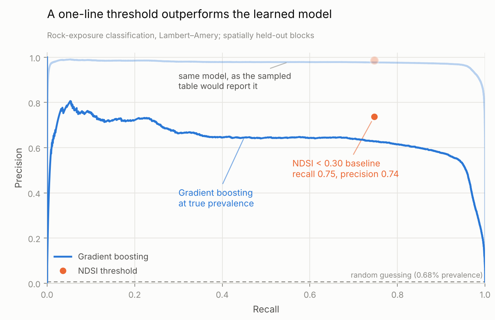

# Stage 1 results

Supervised classification of exposed bedrock from Landsat imagery in the
Lambert–Amery system, benchmarked against a threshold baseline.

**Headline: the threshold baseline outperforms the learned model.** That is
reported here as the result, not buried.

*Light line: precision as the stratified training table reports it. Dark line:
the same model corrected to the 0.68% prevalence of a real scene. The orange
point is the threshold baseline.*

---

## Data

| | |
|---|---|
| Scenes | 2 usable of 3 downloaded (one rejected: 1.1% of pixels survived the QA mask) |
| Product | Landsat 8/9 Collection 2 Level-2, **L2SR** — no thermal band |
| Acquisition | December 2025, sun elevation 33–35° |
| Tier | T2, no ground control points on any scene |
| Labels | SCAR ADD rock outcrop (Burton-Johnson et al., 2016), 22,708 polygons in region, all automated provenance |
| Rows after sampling | 1,203,228 (14.9% rock) |
| True prevalence | **0.681%** (366,385 rock of 53,814,871 labelled pixels) |
| Spatial blocks | 402, of which 51 contain any rock |

Scene contribution is badly unbalanced: one footprint supplies 91% of rows.

## Method

Per-pixel classification from seven reflectance bands, four normalised
indices, three band ratios, brightness, and two texture measures — 17 features.
Compared against `NDSI < 0.30`, a plain threshold stand-in for the published
method.

Three choices do the work of making the numbers mean something:

**Spatially blocked splits.** Adjacent 30 m pixels are not independent draws.
Splits are by whole 10 km block, and blocks are stratified on whether they
contain rock — 351 of 402 contain none, so an unstratified block split can
hand back a test set with almost no positives.

**Precision reported at true prevalence.** Training used stratified sampling
at roughly 1 rock : 5 non-rock. Precision measured on that table is inflated
by the ratio of the odds. Every precision figure below is corrected back to
0.681% via the likelihood ratio. Recall and ROC are prevalence-invariant;
precision is not.

**Accuracy and ROC-AUC are not reported as headline numbers.** At 0.681%
prevalence, predicting "no rock" everywhere scores 99.3% accuracy.

## Results

Spatially held-out blocks, 343,492 rows, 48,257 of them rock.

| | recall | precision (sampled) | **precision (true prev.)** | F1 (true prev.) | false positives |
|---|---|---|---|---|---|
| **NDSI < 0.30** | 0.747 | 0.986 | **0.738** | **0.742** | **500** |
| HistGradientBoosting @ 0.5 | 0.986 | 0.904 | 0.270 | 0.424 | 5,033 |
| HistGradientBoosting @ best F1 | 0.900 | 0.972 | 0.576 | 0.703 | — |
| RandomForest @ 0.5 | 0.997 | 0.880 | 0.223 | 0.364 | 6,561 |

ROC-AUC is 0.9975 for both models. It is reported here only to make the point
that it is uninformative: near-perfect AUC coexists with ten times the
baseline's false-positive count.

### Operating points, gradient boosting

| recall | threshold | precision (sampled) | precision (true prev.) |
|---|---|---|---|
| 0.50 | 0.978 | 0.979 | 0.644 |
| 0.70 | 0.969 | 0.978 | 0.639 |
| 0.80 | 0.960 | 0.976 | 0.615 |
| 0.90 | 0.930 | 0.972 | 0.576 |
| 0.95 | 0.856 | 0.966 | 0.524 |

Tuned to its best operating point the model reaches F1 0.703 against the
baseline's 0.742.

### Generalisation across scenes

| held out | recall | precision (true prev.) | F1 |
|---|---|---|---|
| LC08 127111 (1.09M rows) | 0.937 | 0.094 | 0.172 |
| LC09 130111 (109k rows) | 0.972 | 0.687 | 0.805 |

Training on the small footprint and testing on the large one collapses. With
two scenes, one of which carries 91% of the data, the model is substantially
learning a single footprint.

### Feature importance

Permutation importance on held-out blocks, ROC-AUC scoring:

| feature | importance |
|---|---|
| `tex_bright_std` | 0.0315 |
| `coastal` | 0.0031 |
| `green` | 0.0024 |
| `nbr` | 0.0013 |
| `ndvi` | 0.0010 |
| all others | ≤ 0.0007 |

Brightness texture carries ten times the next feature and roughly sixty times
NDSI. Rock genuinely is rougher than snow at 30 m — but this is also what
would be seen if the model were keying on properties of large contiguous
polygon interiors, which is the subset the edge buffer leaves behind. Treat
as unresolved.

## Why the baseline wins

**The labels are themselves threshold output.** Burton-Johnson et al. derived
the outcrop polygons by applying threshold tests to Landsat 8 bands. A
threshold baseline is therefore partially reproducing the label-generating
function rather than competing with an independent ground truth. The learned
model has to beat that function using *less* information than produced it,
because no thermal band is available here.

This is the label-circularity problem named in the README, measured rather
than hypothesised. It bounds what stage 1 can demonstrate, and it is the
reason the interesting output is the disagreement map rather than a headline
score.

## Known limitations

- **Two scenes, one dominant.** Not enough for a generalisation claim.
- **No thermal band.** USGS does not generate the Level-2 surface-temperature
  product for this region, so every scene is L2SR. Burton-Johnson used thermal;
  this model cannot.
- **Surface reflectance is the wrong product over ice.** LaSRC's aerosol
  retrieval assumes dark targets and over-corrects on snow: 76–84% of
  visible-band pixels returned reflectance above 1.0, and 1–3% returned
  negative values. Unclipped, this put NDSI between −12,198 and +17,653.
  Reflectance is clipped to [0, 1] before any index is computed, which repairs
  the arithmetic but discards within-snow variation. **Level-1 TOA reflectance
  is the correct product here** and is the planned fix.
- **Geolocation unverified.** No scene carries a `GEOMETRIC_RMSE_MODEL` —
  there are too few ground control points on an ice sheet — so all are
  positioned from spacecraft ephemeris. A 60 m label edge buffer absorbs
  this, at the cost of erasing small polygons.
- **Small outcrops are invisible to training.** 77% of polygons in the region
  are under ten Landsat pixels, with a median of two. Eroded by the edge
  buffer they have no interior and become EXCLUDE. They are only ~1% of
  outcrop *area*, so the pixel count is barely affected — but the model never
  sees an isolated small exposure, which is the case that matters most for
  finding new sample sites.
- **The baseline is a stand-in.** `NDSI < 0.30` is not the published
  algorithm, which uses additional tests and was tuned continent-wide. No
  claim is made here about outperforming the published method.

## Next

In rough order of expected value:

1. **More scenes.** Five or six usable footprints, which would make a
   generalisation claim possible at all.
2. **Level-1 TOA reflectance** in place of clipped surface reflectance.
3. **Resolve the texture result** — if `tex_bright_std` is keying on polygon
   size rather than surface roughness, the model is learning the label
   geometry rather than the ground.
4. **Map the disagreements.** Where model and benchmark differ, and whether
   those differences are defensible on inspection of the imagery. This is the
   output stage 1 was built to produce.
