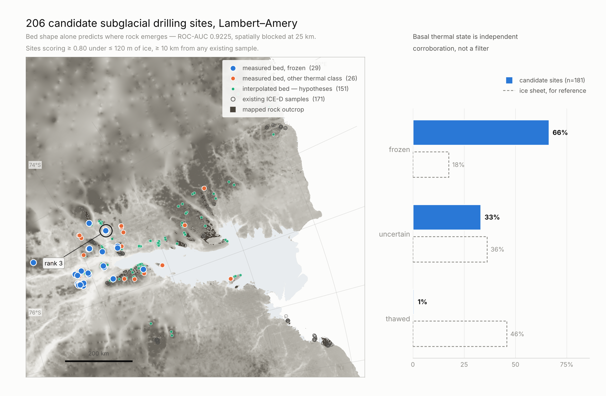

# Stage 2 results

Candidate subglacial drilling sites in the Lambert–Amery system: bedrock
shallow enough to reach, in a setting that elsewhere produces exposure, far
enough from existing measurements to add information.

**206 candidate sites. 55 sit over bed that has actually been measured by
radar; the other 151 sit over interpolation and are reported separately as
hypotheses. 29 are both radar-measured and frozen-bedded.**

**Independent corroboration: 66% of candidate sites sit on bed that two
independent methods agree is frozen, against 18% ice-sheet-wide. Exactly one
of 206 is over a thawed bed.** The thickness filter was chosen for drilling
logistics alone, with no thermal input — see *Basal thermal state* below.

---

## Question

Cosmogenic constraints on past ice thickness can only be made where bedrock
is reachable. Exposed outcrop is ~0.18% of Antarctica and the sampled
fraction is far smaller again. Subglacial bedrock recovered by drilling
extends the reach, but drilling is expensive and the signal survives only
where the bed is cold-based.

> Does the **shape of the bed**, knowing nothing about the ice above it,
> predict where rock emerges? If so, the same signature under thin ice marks
> a near-miss peak.

## Method

Positives are 500 m cells containing mapped outcrop; negatives are grounded
cells without it. Predictors are **bed geometry only**: local relief at 10 km
and 50 km, and bed slope. The model is then inverted — cells scoring high
that are currently ice-covered are near-miss peaks.

### Feature selection by ablation, not by importance

The first run used every available predictor and scored ROC-AUC 0.9957. That
was leakage. `ice_thickness` carried 5.6× the importance of anything else
because **outcrop is where ice thickness is zero**, and Bedmap3 derives
thickness partly from the same rock mask the labels come from. Everything
measured at or above the ice surface is contaminated the same way: surface
elevation equals bed elevation at an outcrop, surface slope is steep beside
one, ice moves slowly over one.

Restricting to bed features left `dist_to_water_km` dominating permutation
importance at 10× the next feature — a geographic proxy, not geomorphology.
Ablation showed that was redundancy rather than signal:

| predictors | ROC-AUC | avg precision |
|---|---|---|
| all five bed features | 0.969 | 0.769 |
| without `dist_to_water` | 0.937 | 0.647 |
| **relief + slope only** | **0.933** | **0.646** |
| `dist_to_water` alone | 0.819 | 0.249 |
| `bed_elevation` alone | 0.769 | 0.276 |

Dropping both costs almost nothing and buys a model that cannot have simply
memorised where the Prince Charles Mountains are.

**Final model, spatially blocked cross-validation at 25 km: ROC-AUC 0.9225,
average precision 0.6470.** Bed shape alone does predict where rock emerges.

## Filters

Two hard, set by the user:

| filter | value | reason |
|---|---|---|
| ice thickness | ≤ 120 m | realistic bedrock-recovery depth |
| distance from ICE-D site | ≥ 10 km | closer adds little new information |

Surface velocity is deliberately **not** a filter. What erases the signal in
subglacial bedrock is a warm-based sliding bed; cold-based ice can preserve a
surface for millions of years while still deforming internally, and slow ice
can be warm-based. Basal thermal state is the right variable, and it is a
reported column rather than a gate — the published synthesis is on an 8 km
grid and classes 36% of the ice sheet "uncertain".

Two physical checks, applied before ranking rather than after:

- **positive bed relief** — a cell whose bed sits below its surroundings is a
  hollow. An earlier cell-level ranking put a cell 112 m *below* its
  surroundings at number one.
- **bed uncertainty < ice thickness** — a bed known to ±152 m under 102 m of
  ice is not established well enough to call shallow.

18,072 candidate cells → 4,205 after the checks → 366 scoring ≥ 0.80.

## Sites, not cells

An earlier version ranked cells, and put the same 2 km massif in the top 50
seven times. Cells are clustered by 8-connectivity into sites; each site
reports its best cell, its area, its thinnest ice and its best-constrained
bed.

**Sites are ranked radar-surveyed first, then by score.** With 91% of the
grounded bed never sounded, a confident score over interpolated terrain is a
statement about Bedmap3's interpolation, not about a mountain. Two tiers keep
that visible rather than buried in a column.

## Basal thermal state

From Seiner et al., *A synthesis of the basal thermal state of the Antarctic
ice sheet* (Zenodo 10.5281/zenodo.15556691), `agreement` layer: 0 = both
methods agree frozen, 1 = uncertain, 2 = both agree thawed, 3 = ice-free
land. The ice-sheet-wide split reproduces as 17.6 / 36.3 / 45.9, matching the
published 18 / 36 / 46.

Of the 181 candidate sites with a usable ice classification (14 fall in 8 km
cells the product calls ice-free land, 11 have no value):

| | candidate sites | Lambert–Amery region | ice sheet |
|---|---|---|---|
| frozen | **66%** | 23% | 18% |
| uncertain | 33% | 37% | 36% |
| thawed | **1%** | 40% | 46% |

**One site of 206 is over a thawed bed.** Frozen beds are enriched roughly
threefold against the regional background and nearly fourfold against the
ice sheet.

This is independent corroboration rather than a design feature. The ≤120 m
filter was set on drilling logistics with no thermal input, and the thermal
product comes from nine ISMIP6 thermomechanical models plus a slip-ratio
test — nothing in common with Bedmap3 thickness. Thin ice insulates poorly,
so a drillable bed in the East Antarctic interior is very likely a frozen
one, and the condition that makes a site reachable turns out to be close to
the condition that makes its cosmogenic signal survive.

The 8 km grid is coarse against 500 m candidates, so this describes the
regional setting rather than the site. It is reported, not filtered on. The
single thawed site should be dropped.

The map shows the three evidence classes separately: sites over measured
bed with an agreed frozen regime, sites over measured bed in another
thermal class, and sites over interpolated bed. Open circles are the 171
existing ICE-D samples in the region.

## Top sites with measured bed

| rank | lat | lon | thinnest ice (m) | bed relief 10 km (m) | bed unc. (m) | km from ICE-D | soundings |
|---|---|---|---|---|---|---|---|
| 1 | −72.17 | 68.80 | 28 | 1,478 | 21 | 90 | 1 |
| 2 | −72.15 | 68.79 | 48 | 1,363 | 12 | 88 | 2 |
| 3 | −73.15 | 63.97 | 23 | 1,501 | 12 | 48 | 69 |
| 4 | −73.86 | 63.20 | 63 | 1,348 | 12 | 40 | 26 |
| 5 | −74.36 | 66.62 | 20 | 1,008 | 12 | 94 | 73 |
| 6 | −73.16 | 63.93 | 13 | 1,348 | 12 | 47 | 8 |
| 10 | −72.75 | 64.27 | 24 | 1,268 | 12 | 75 | 135 |

Rank 3 is the clearest: 23 m of ice over a peak standing 1,500 m above its
surroundings, 69 radar soundings, bed known to ±12 m, 48 km from the nearest
existing sample.

**29 sites are both radar-measured and frozen-bedded** — the subset where the
bed depth is known, the thermal regime is agreed, and no prior sample sits
within 10 km. Ranks 3, 5 and 6 lead it.

Full list in `stage2_sites_final.csv`: latitude, longitude, area, thickness,
relief, bed uncertainty, survey count, distance to nearest ICE-D site and
basal thermal class for all 206.

## Limitations

- **Thin ice may mean mapping error, not shallow burial.** Several top sites
  have 13–28 m of ice. Some may be blue ice or thin snow over rock the
  outcrop map missed. Stage 1's disagreement map is the natural cross-check.
- **91% of the grounded bed is unsounded.** The two-tier ranking manages this
  but does not solve it.
- **Bed uncertainty is quantised** — values cluster at 12, 21, 73, 86 and
  152 m rather than varying continuously. The `< ice thickness` test is
  therefore coarser than it looks.
- **Basal thermal state is 8 km data on 500 m candidates.** It characterises
  the region a site sits in, not the site. 14 candidates fall in cells the
  product calls ice-free land and 11 have no value at all — both resolution
  artefacts near outcrop and coastline.
- **Outcrop presence is a proxy for the thing of interest.** The model learns
  where rock is exposed today, which reflects erosional and climatic history
  as well as bed shape. A buried peak that looks like an exposed one is a
  reasonable hypothesis, not a prediction.
- **No field validation.** Nothing here has been checked against an actual
  drilling campaign.
